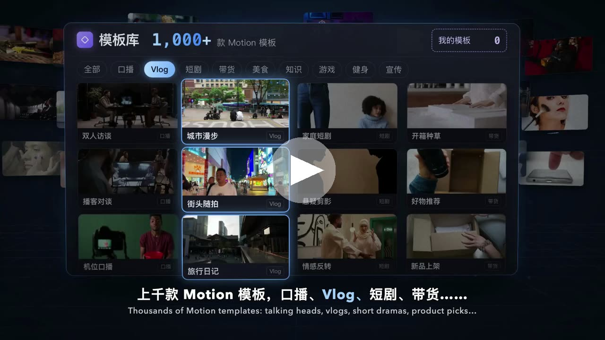

# 阿杜导演 · 开源

**你的视频创作 AI 助手**

官网 **[www.adudir.com](https://www.adudir.com/)** · 内测申请 **[www.adudir.com/beta](https://www.adudir.com/beta/)** · 模板社区 **[motiongit.com](https://motiongit.com)**

点上图播放介绍视频（57 秒）· [1080p 高清版](https://media.openaicut.com/adudir/site/adudir-intro-7367fb633710.mp4)

[中文](#中文) · [English](#english)

---

## 中文

阿杜导演把剪辑写成代码：你说要什么，阿杜直接改工程，每一处改动你都看得见、撤得回。口播、讲解、Vlog、宣传片、视频翻译，上千款 Motion 模板换上你的内容就能出片。软件完全免费，无需注册登录；AI 剪辑由 Token 驱动，消耗由你自己控制。

### 这次开源什么

这次开源是为了**帮大家理解 .motion 格式和协议**：一个 .motion 模板里有什么，页面怎样按时间 t 出帧，参数、素材、使用指南怎么写，剪辑器和模板之间按什么约定读取、预览、替换内容、导出。剪辑器拿到 .motion 后怎么用，只用一页简单说明。

| 内容 | 说明 |
|---|---|
| [docs/motion-format.md](docs/motion-format.md) | **主文档**：.motion 格式与协议 |
| [docs/using-templates.md](docs/using-templates.md) | 在阿杜导演里怎么用一个模板，从打开到出片 |
| [docs/editor-architecture.md](docs/editor-architecture.md) | 剪辑器怎样使用 .motion（一页） |
| [templates/paper-perspective-talking-head/](templates/paper-perspective-talking-head/) | 模板结构示例（清单、参数、使用指南、预览图）：「纸面透视 · 口播讲解」v2.7.9 |
| [brand/](brand/) | 阿杜导演的应用图标和阿杜表情形象 |

### 分阶段开源计划

阿杜导演按阶段逐步开源，每一阶段都可以单独阅读和使用。新阶段开放前，会先在这里更新。

| 阶段 | 主题 | 开放内容 | 状态 |
|---|---|---|---|
| **第一阶段** | .motion 格式与模板 | .motion 格式与协议文档；剪辑器怎样使用 .motion；一个模板结构示例（清单、参数、使用指南、预览图） | ✅ **已开放（当前）** |
| **第二阶段** | 模板接入与预览 | 把 .motion 模板接进任意剪辑器的参考实现：读取和校验、按时间预览、参数面板、替换内容；给 AI 助手用的模板操作说明（skill 和命令行范例） | 计划中 |
| **第三阶段** | 时间线格式与 AI 协作编辑 | 代码式时间线的数据格式规范；AI 改工程的结构化修改与撤销约定；跟随修改的展示方式；更多模板示例，和社区一起完善 .motion 生态 | 计划中 |

**第一阶段包含：**
- [docs/motion-format.md](docs/motion-format.md)：.motion 格式与协议（主文档）
- [docs/using-templates.md](docs/using-templates.md)：在阿杜导演里怎么用一个模板
- [docs/editor-architecture.md](docs/editor-architecture.md)：剪辑器怎样使用 .motion
- [templates/paper-perspective-talking-head/](templates/paper-perspective-talking-head/)：「纸面透视 · 口播讲解」模板结构示例（清单、参数、使用指南、预览图）

**第二阶段计划：**
- 模板读取和校验工具：检查一个 .motion 是否完整、参数是否合法
- 按时间预览器：给定时间 t 渲染模板画面，可嵌入任意剪辑器
- 参数面板与内容替换的参考组件
- 给 AI 助手用的模板操作说明和命令行范例

**第三阶段计划：**
- 代码式时间线的数据格式规范和示例工程
- AI 修改工程的结构化格式：每一处改动可见、可撤销
- 跟随修改（改动过程可视化）的展示方式
- 更多类型的模板示例：知识讲解、Vlog、产品宣传

### 许可

- 代码和文档：[MIT](LICENSE)。
- 模板结构示例：清单和说明 MIT，字体 SIL OFL 1.1，见模板目录下的 `licenses/`。示例只含说明性的文件，不含运行代码；演示人物、示例配音和配乐没有放进仓库，封面里的人物位置是占位图。
- `brand/` 下的图标和阿杜形象是阿杜导演的品牌素材，不在 MIT 许可范围内。

支持邮箱：imichaeldu@gmail.com

---

## English

ADu Director turns editing into code: say what you want, ADu edits the project directly, and you can see and undo every
change. Talking heads, explainers, vlogs, promos and video translation — swap your content into one of thousands of
Motion templates and render. Completely free, no sign-up or login; AI editing runs on tokens, and you control the
consumption.

### What this release opens

This release is about **understanding the .motion format and protocol**: what a .motion template contains, how pages
draw the frame for time t, how parameters, media and guides are written, and the contract an editor and a template
follow to read, preview, replace content and export. How an editor uses .motion gets a one-page note.

| Path | Contents |
|---|---|
| [docs/motion-format.md](docs/motion-format.md) | **Main document**: the .motion format and protocol |
| [docs/using-templates.md](docs/using-templates.md) | How to use a template in ADu Director, from opening it to the final render |
| [docs/editor-architecture.md](docs/editor-architecture.md) | How an editor uses .motion (one page) |
| [templates/paper-perspective-talking-head/](templates/paper-perspective-talking-head/) | Template structure example (manifest, parameters, guide, previews): "Paper Perspective · Talking Head" v2.7.9 |
| [brand/](brand/) | ADu Director app icons and ADu character art |

### Open-source roadmap

ADu Director opens up in stages; each stage can be read and used on its own. This section is updated before a new stage
opens.

| Stage | Theme | What opens | Status |
|---|---|---|---|
| **Stage 1** | .motion format and templates | the .motion format and protocol; how an editor uses .motion; one template structure example (manifest, parameters, guide, previews) | ✅ **Open (now)** |
| **Stage 2** | Template integration and preview | a reference implementation for plugging .motion templates into any editor — reading and validation, preview at time t, parameter panel, content replacement; template instructions for AI assistants (skills and CLI examples) | Planned |
| **Stage 3** | Timeline format and AI co-editing | the data format of a code-native timeline; structured, undoable AI edits; how follow-along edits are shown; more template examples with the community | Planned |

### License

Code and docs: [MIT](LICENSE). Template structure example: manifest and notes MIT, fonts SIL OFL 1.1 (see the template's `licenses/`); it holds descriptive files only, no runtime code. The icons
and character art in `brand/` are ADu Director brand assets and are not covered by the MIT license.

Support: imichaeldu@gmail.com · Website: [www.adudir.com](https://www.adudir.com/)
