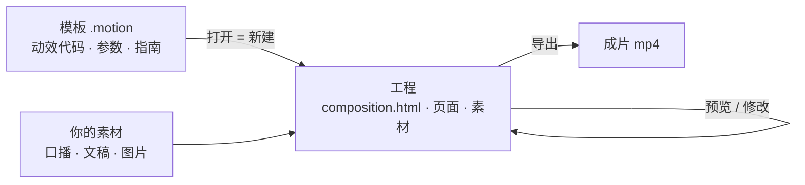
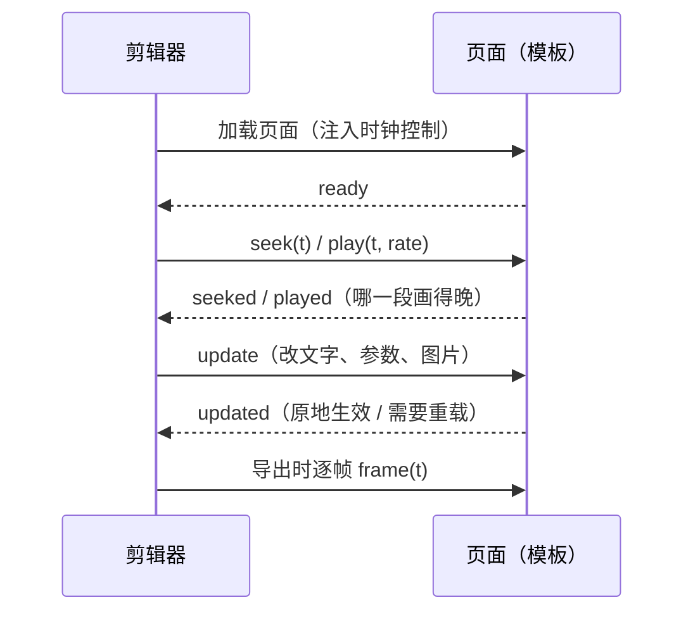

# .motion 格式与协议

> 一句话：.motion 把一条视频写成一份能读、能改、能对比的代码。画面动效是网页代码，每一帧只由时间 t 决定；素材只被引用、不被改动；剪辑本身写在文本文件里。任何遵守这份约定的剪辑器，都能打开、预览、修改、导出同一个 .motion。

*English summary at the end.*

目录

1. [.motion 是什么](#1-motion-是什么)
2. [模板包结构](#2-模板包结构)
3. [motion.json](#3-motionjson)
4. [页面：给定时间 t，画面就是确定的那一帧](#4-页面给定时间-t画面就是确定的那一帧)
5. [参数](#5-参数)
6. [素材](#6-素材)
7. [使用指南 guide.json](#7-使用指南-guidejson)
8. [工程](#8-工程)
9. [剪辑器与模板之间的协议](#9-剪辑器与模板之间的协议)
10. [对照：本仓库的模板](#10-对照本仓库的模板)

---

## 1. .motion 是什么

一个 `.motion` 文件是一个 **ZIP 包**，根目录必须有 `motion.json`。读 `motion.json` 就知道它是哪一种：

| 种类 | 怎么认 | 用途 |
|---|---|---|
| **模板** | `"format": "motiongit-template"`，带 `specVersion` | 写好的动效代码 + 开放的参数 + 使用指南。打开时新建工程，模板本身不被改动 |
| **工程** | `"format": "adudir-motion-project"`，带 `composition.html` | 你这一期的片子。解开编辑，保存回同一个文件 |



---

## 2. 模板包结构

```text
my-template.motion            (ZIP)
├── motion.json               模板身份、运行方式、输出规格、参数入口、许可          必需
├── guide.json                给 AI 助手的使用指南                                推荐
├── params.schema.json        参数合同（JSON Schema）                             有参数时必需
├── presets/                  示例参数，比如 demo.json
├── src/                      页面代码（HTML / CSS / JS）
├── assets/                   模板自带素材
├── asset-manifest.json       每个素材的来源和许可
├── previews/                 封面、预览
├── licenses/                 代码、字体、素材各自的许可
├── integrity.json            每个文件的 SHA-256
└── README.md                 给人看的说明
```

---

## 3. motion.json

必填字段：

```json
{
  "format": "motiongit-template",
  "specVersion": "0.1.0-draft.1",
  "template": { "id": "paper-talk", "version": "1.0.0", "name": "纸面透视 · 口播讲解" },
  "runtime":  { "profile": "adudir.page/1", "entry": "src/index.html" },
  "output":   { "width": 1920, "height": 1080, "fps": { "num": 60, "den": 1 } }
}
```

常用的可选字段：

| 字段 | 作用 |
|---|---|
| `template.description` / `template.language` | 简介、语言 |
| `runtime.engine` | 运行引擎的名字和版本 |
| `parameters.schema` / `parameters.defaultPreset` | 参数合同和默认参数 |
| `output.durationPolicy` | 时长怎么定：固定秒数，或跟着配音走（`fit-voiceover`） |
| `output.layouts` | 横屏、竖屏各自的尺寸 |
| `ai.entry` / `ai.guide` | AI 助手先读哪个文件 |
| `preview.cover` / `preview.portraitCover` | 封面 |
| `license.file` | 许可文件 |
| `integrity` | 完整性清单，默认 `integrity.json` |
| `assets.manifest` | 素材清单 |

`runtime.profile` 决定模板怎么跑：

- **页面模板**（`adudir.page/1`）：模板就是一个或几个动效页面，打开后直接放上时间线，改文字、换图、调参数就能出片。
- **生成式模板**：模板根据你的素材和参数生成整部片子的工程，生成在阿杜导演和 MotionGit 里完成。本仓库的模板结构示例就是这一种。

---

## 4. 页面：给定时间 t，画面就是确定的那一帧

页面是普通网页，对剪辑器只承诺一件事：**同一个时间 t，无论画第几次、在哪台机器上画，画面都一样。**

### 4.1 页面接口

页面在 `window.film` 上声明自己：

```js
window.film = {
  duration: 8,                 // 秒，可选
  ready: document.fonts.ready, // 准备好之前不要画，可选
  frame(t) {                   // 必填：把画面画到时间 t，可以返回 Promise
    title.style.opacity = Math.min(1, t / 0.6)
    card.style.transform = `translateY(${(1 - ease(t / 0.8)) * 40}px)`
  },
  params: { /* 见第 5 节 */ },
}
```

### 4.2 规则

- 画面只由 `t` 决定。动画进度、随机数、视频当前帧，都从 `t` 算出来。
- 在剪辑器里运行时，页面不自己用定时器播放，等剪辑器调用 `frame(t)`。
- 剪辑器画每一帧时，会把页面里的时钟（`performance.now`、`Date`、`requestAnimationFrame`、CSS 动画、`Math.random`）固定在 `t`，所以用了这些 API 的页面也能逐帧确定。
- 用 `renderAt(t)`、`seek(t)` 这类函数名出帧的页面，剪辑器会自动接到 `frame(t)` 上。

### 4.3 片段时间

页面放在时间线上就是一个片段，片段记三个数：在片子的第几秒开始（`at`）、从页面自己的第几秒截起（`in`）、截多长。剪辑器画片子第 `T` 秒时调用：

```text
frame( in + (T − at) )
```

所以同一个页面可以被截成好几段，放在不同位置。

### 4.4 给剪辑器的提示

| 属性 | 作用 |
|---|---|
| `data-film-sample` | 这是样例内容（样例图、样例文字），出片前提醒替换 |
| `data-film-ranges` | 这个元素什么时候出现，时间线可以按真实出现时间显示 |
| `data-film-decor` | 纯装饰，不当作内容 |

文字被框裁掉时，剪辑器也会检测出来提醒。这些都只是提醒，不拦着出片。

---

## 5. 参数

### 5.1 页面参数

页面在 `film.params` 里声明可以调的参数，剪辑器据此生成参数面板：

```js
window.film.params = {
  accent: { type: 'color',  default: '#2FD3B4', label: '强调色' },
  speed:  { type: 'number', default: 1, min: 0.5, max: 2, step: 0.1, label: '节奏' },
  title:  { type: 'text',   default: '先说明条件，再给出判断', maxLength: 24, label: '标题' },
  grid:   { type: 'toggle', default: true, label: '背景网格' },
}
```

- 四种类型：颜色、数值（滑块 + 数字框）、文本、开关。每个参数必须有 `default`。
- 参数值成为页面根节点上的 CSS 变量（`--accent`、`--speed`……），页面用 CSS 或 JS 读它。
- 改过的值写进工程，只记和默认值不同的部分，模板本身不变。

### 5.2 生成式模板的参数

写在 `params.schema.json` 里，用 JSON Schema 描述整部片子可以填的内容，比如画幅、时长和每一段显示的文字。例子见本仓库模板的 `presets/`。

---

## 6. 素材

- 模板自带的素材放在 `assets/`，每一个都在 `asset-manifest.json` 里写明来源和许可。
- 工程里的素材**只被引用、不被改动**：片段记的是「原文件的第几秒到第几秒」，同一个文件可以被很多片段引用。
- 字幕是 `.vtt`，放在对应的配音或素材旁边。
- 示例素材只用来演示；正式制作换成用户自己的口播、人物、图片和有授权的音乐。

---

## 7. 使用指南 guide.json

`guide.json` 是写给 AI 助手的。剪辑器把它交给助手，助手照着和用户对话、准备素材、选动画。

| 字段 | 作用 |
|---|---|
| `firstReply` | 打开模板后，助手先对用户说的第一句话 |
| `materials` | 需要哪些素材，哪些必需，缺了怎么办 |
| `fit` / `duration` | 适合什么内容，时长怎么定 |
| `selection` / `styles` | 怎么按内容选动画 |
| `conversation` | 对话约定：不让用户填技术表格，按用户已有的素材选路线 |

一份好的指南让助手**先理解用户的内容，再选动画**，而不是把示例原样套上去。

---

## 8. 工程

从模板新建的工程是一个普通文件夹，保存成 .motion 时打成 ZIP：

| 文件 | 内容 |
|---|---|
| `motion.json` | 工程名、版本、修订号、来自哪个模板 |
| `composition.html` | **整部片子的剪辑**：几条轨道，每个片段用哪个页面或素材、截哪一段、放在哪个时间点、大小位置、参数值、转场、音量 |
| 页面 `*.html` | 动效页面，规则见第 4 节 |
| `cues.json` | 线索点：给时间线上的时间点起名字，方便引用 |
| `*.vtt` | 字幕 |
| `assets/` | 素材、配音、音乐、音效 |

工程的 `motion.json`：

```json
{
  "format": "adudir-motion-project",
  "specVersion": "2.0.0",
  "packageProfile": "adudir-motion-project/2",
  "project": { "id": "…", "name": "第 12 期", "revision": 3,
               "source": { "kind": "motiongit-template", "template": "paper-talk", "entry": "src/index.html" } },
  "runtime": { "profile": "adudir.composition/1", "entry": "composition.html" }
}
```

工程是文本文件，每次修改都是几行文字的变化，可以逐行对比、逐步撤销。

---

## 9. 剪辑器与模板之间的协议

这一节是剪辑器和模板双方都要遵守的约定。



### 9.1 读取

1. 确认是 ZIP，根目录有 `motion.json`，必填字段齐全。
2. 有 `integrity.json` 的，逐个文件核对 SHA-256。
3. 把模板解到一个新的工作目录，**不改模板本身**。
4. 按 `runtime.entry` 找入口页面；没有就找 `index.html`。
5. 写一个新工程：`composition.html` 里放入模板页面作为片段，工程 `motion.json` 记下来源模板和版本。

### 9.2 预览

- 剪辑器负责时钟，页面只按 `t` 出帧。**声音是主时钟**，画面跟着声音走。
- 剪辑器和页面之间只传少量消息：跳到某一刻、从某一刻按某个速度播放、更新内容；页面回报准备好了、画完了、哪一段画得晚。
- 改文字、参数这类修改原地生效；页面说需要重载时，剪辑器先在后面准备好新画面再换上来。

### 9.3 替换内容

| 改什么 | 剪辑器从哪里知道 | 写到哪里 |
|---|---|---|
| 文字 | 页面里的文字层 | 工程里该片段的覆盖值 |
| 参数 | `film.params` 声明 | 片段的覆盖值（只记非默认值） |
| 图片、视频 | 页面里的图片、时间线素材片段 | 替换素材引用；换视频时先选用哪一段，片段只能变短 |
| 字幕 | 素材旁的 `.vtt` | 同一个 `.vtt` |
| 线索点 | `cues.json` | 同一个 `cues.json` |
| 样例内容 | `data-film-sample` | 出片前提醒，不拦 |

模板文件始终不变，所有修改都落在工程里。

### 9.4 导出

- 动效页面按 `t` 逐帧画出来；拍摄素材直接解码、缩放、编码，保留原片的分辨率。两者在同一个帧格上合成。
- 声音单独混音，不从画面里录。
- 因为每一帧都由 `t` 决定，导出可以分段并行、断点续导，改了哪一段只重画哪一段。

---

## 10. 对照：本仓库的模板

[`templates/paper-perspective-talking-head/`](../templates/paper-perspective-talking-head/) 是一个生成式口播模板的**结构示例**，只含说明性的文件，不含运行代码：

- `motion.json`：模板身份、输出规格（横屏 1920×1080、竖屏 1080×1920，60fps）、参数入口和许可。其中指向代码和引擎的入口保持原样，只为展示完整的清单写法，对应文件没有放进仓库。
- `params.schema.json`、`native.params.schema.json`：参数合同。
- `presets/`：示例参数。
- `guide.json`：给 AI 助手的使用指南。
- `previews/`：横屏、竖屏封面。
- `licenses/`、`assets/fonts/`：许可和随包字体。

出片由阿杜导演和 MotionGit 完成。怎么在阿杜导演里用模板，见 [using-templates.md](using-templates.md)。

---

## English summary

- A `.motion` file is a ZIP with `motion.json` at its root. `"format": "motiongit-template"` marks a **template**
  (opened as a new project, never modified); `"format": "adudir-motion-project"` with `composition.html` marks a
  **project**.
- Template layout: `motion.json` (required: `format`, `specVersion`, `template.{id,version,name}`,
  `runtime.{profile,entry}`, `output.{width,height,fps}`), `guide.json`, `params.schema.json`, `presets/`, `src/`,
  `assets/` + `asset-manifest.json`, `previews/`, `licenses/`, `integrity.json`, `README.md`.
- **Page contract:** `window.film = { frame(t), duration?, ready?, params? }`. The same `t` always draws the same
  picture; the editor pins clocks and randomness to `t`. A clip draws `frame(in + (T − at))`. Hints:
  `data-film-sample`, `data-film-ranges`, `data-film-decor`.
- **Parameters:** `film.params` declares color / number / text / toggle with defaults; values become CSS variables;
  only non-default values are stored in the project. Generator templates describe the whole film in
  `params.schema.json`.
- **Project:** `motion.json`, `composition.html` (the whole edit), pages, `cues.json`, `.vtt` captions, `assets/`.
  Footage is referenced by in/out points and never modified.
- **Protocol:** read (check fields and `integrity.json`, unpack into a fresh workspace, find the entry, write a new
  project), preview (the editor owns the clock, audio is master; seek / play / update ↔ ready / seeked / played /
  updated), replace content (overrides in the project, never in the template), export (pages per frame, footage
  decoded directly, composited on one frame grid, audio mixed separately).
- The template in this repo is a **structure example**: manifest, parameter contracts, presets, guide, previews,
  licenses and fonts only, no runtime code. Rendering is done in ADu Director and MotionGit.
