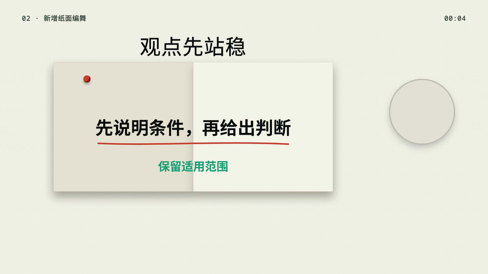

# 纸面透视 · 口播讲解 / Paper Perspective · Talking Head

**这是模板结构示例，不含运行代码；出片由阿杜导演和 MotionGit 完成。**

模板 607，版本 2.7.9。用纸面透视、卡片层次和图文关系配合口播，适合方法拆解与结构化知识。横屏 1920×1080、竖屏 1080×1920，60fps。这里只放说明性的文件，用来对照 [.motion 格式与协议](../../docs/motion-format.md) 理解一个模板的清单、参数和使用指南怎么写。

## 目录

| 路径 | 内容 |
|---|---|
| `motion.json` | 示例清单：模板身份、输出规格、参数入口、封面、许可的格式骨架。不含运行代码，所以没有列出运行入口 |
| `guide.json` | 示例使用指南：模板名、用途、适合的素材、参数分组 |
| `params.schema.json`、`native.params.schema.json` | 示例参数合同：品牌名、标题文字、主色、图片等十项以内，说明合同长什么样 |
| `presets/` | 按示例合同填好的两组参数 |
| `previews/` | 横屏、竖屏封面 |
| `media-input-keys.json` | 素材槽位名 |
| `brand/` | 右上角署名角标的占位动画 |
| `assets/fonts/` | 随包字体 |
| `licenses/` | 模板和字体的许可 |

在阿杜导演里怎么用模板，见 [docs/using-templates.md](../../docs/using-templates.md)。

## 素材说明

- `previews/cover*.jpg` 是模板画面截图，演示人物的位置换成了纸色圆盘占位。
- `brand/` 下是中性的圆环占位动画。
- 示例配音、演示人物视频和默认配乐没有放进来。

## 许可

清单和说明 MIT（`licenses/TEMPLATE-LICENSE.txt`），字体 SIL OFL 1.1（`licenses/*OFL*.txt`）。

---

## English

**This is a template structure example with no runtime code; rendering is done in ADu Director and MotionGit.**

Template 607 "Paper Perspective · Talking Head", version 2.7.9: paper-perspective cards and text/picture layering
that follow a talking head; landscape 1920×1080 and portrait 1080×1920 at 60 fps. Only descriptive files are here —
an example manifest (`motion.json`, the format skeleton without a runtime entry), an example guide (`guide.json`: name,
purpose, suitable materials, parameter groups), example parameter contracts (ten fields or fewer: brand name, title,
accent color, an image), two presets, cover previews,
media slot names, placeholder corner-mark animations, fonts and licenses. Read it alongside the
[.motion format and protocol](../../docs/motion-format.md). License: manifest and notes MIT, fonts SIL OFL 1.1.
